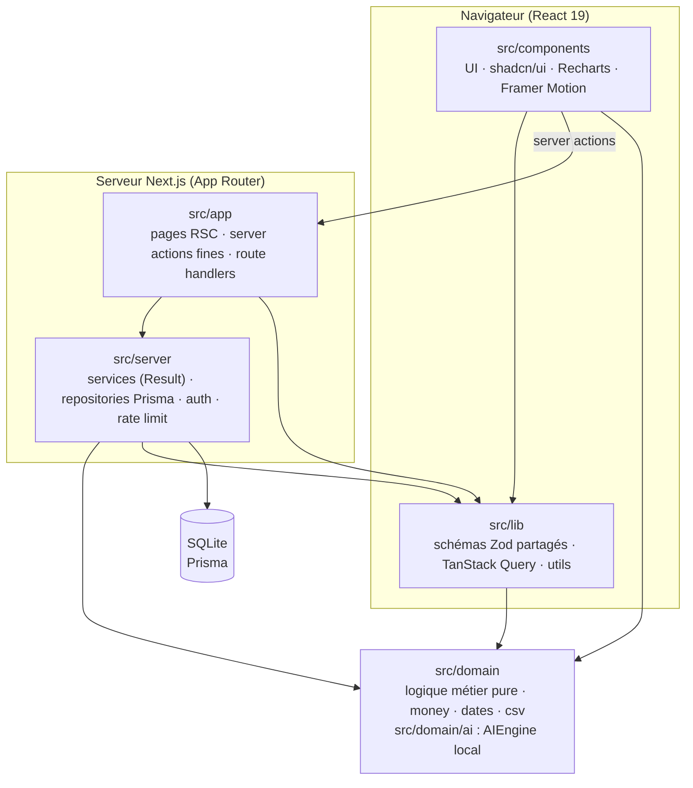
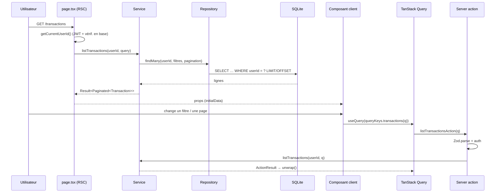
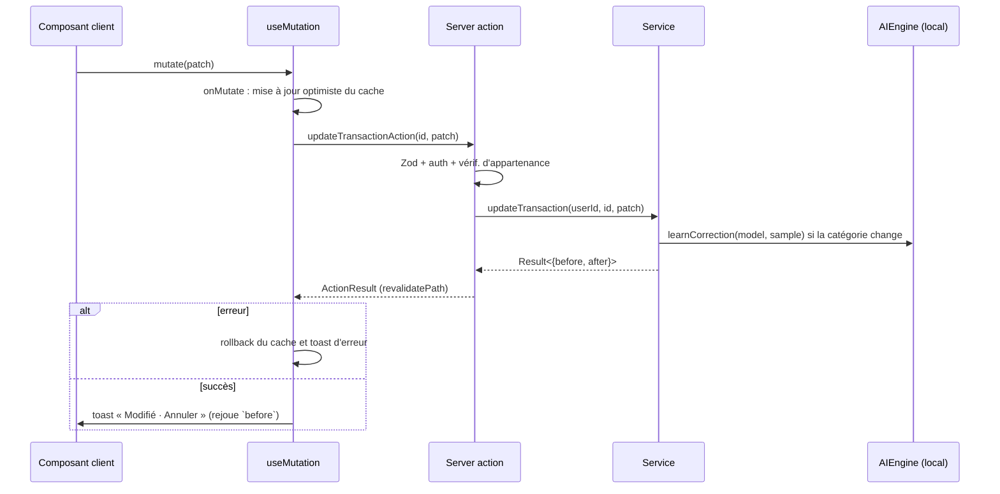
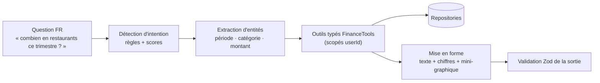

# Architecture de Masrouf

## Principes

1. **Couches séparées.** Les dépendances ne vont que vers l'intérieur. ESLint (`no-restricted-imports`) fait respecter cette règle.
2. **Domaine pur.** `src/domain` ne dépend de rien : pas de framework, pas de Prisma, pas de Zod. Il contient la logique métier et toute l'IA.
3. **Argent en entiers.** Les montants sont des millimes entiers, de la base de données jusqu'à l'affichage. `formatMoney` (`src/domain/money.ts`) est la seule fonction de formatage, et le composant `<Money>` s'appuie sur elle.
4. **Validation Zod à chaque frontière.** Elle s'applique aux formulaires, aux server actions, à l'import CSV, au modèle IA chargé depuis la base et aux sorties du moteur IA.
5. **Erreurs typées.** Les services renvoient un `Result<T, AppError>`. Une exception imprévue est journalisée puis convertie en `INTERNAL` ; aucune n'est avalée.
6. **Isolation des données.** Chaque fonction de repository prend `userId` en premier paramètre et filtre dessus. Une ressource référencée (compte, catégorie…) est vérifiée comme appartenant à l'utilisateur avant toute écriture.

## Couches



| Couche           | Peut importer                              | Ne doit jamais importer                             |
| ---------------- | ------------------------------------------ | --------------------------------------------------- |
| `src/domain`     | rien (uniquement ses propres fichiers)     | `next`, `react`, `@prisma/*`, `zod`, autres couches |
| `src/lib`        | `src/domain`, `zod`, utilitaires UI        | `src/server` (sauf `import type`)                   |
| `src/server`     | `src/domain`, `src/lib`, Prisma, Auth.js   | `src/app`, `src/components`, `react`                |
| `src/app`        | toutes les couches                         | —                                                   |
| `src/components` | `src/domain`, `src/lib`, `src/app/actions` | `src/server` (sauf `import type`), Prisma           |

## Flux de données

### Lecture (rendu serveur, puis interactivité client)



### Écriture (optimiste, avec « Annuler »)



### IA locale



`src/server/ai/engine.ts` est le seul point d'injection. L'application ne dépend que de l'interface `AIEngine` (`src/domain/ai/engine.ts`). Changer d'implémentation consiste à modifier cette seule ligne.

## Choix techniques

| Sujet                    | Choix                                                                                                                       | Raison                                                                                                                                                                                       |
| ------------------------ | --------------------------------------------------------------------------------------------------------------------------- | -------------------------------------------------------------------------------------------------------------------------------------------------------------------------------------------- |
| Dates métier             | `String "YYYY-MM-DD"` en base                                                                                               | La comparaison lexicographique suit l'ordre chronologique, sans piège de fuseau horaire. « Aujourd'hui » est calculé en Africa/Tunis.                                                        |
| Plafond des montants     | 999 999,999 DT par montant (`MAX_AMOUNT_MILLIMES`)                                                                          | Les colonnes SQLite sont des INT 32 bits : rien ne peut déborder, et l'erreur P2023 devient VALIDATION.                                                                                      |
| Montants                 | `Int` (millimes)                                                                                                            | Pas d'erreur d'arrondi flottant. Le dinar a 3 décimales.                                                                                                                                     |
| Enums                    | `String` validée par Zod                                                                                                    | SQLite n'a pas d'enum natif. Les unions TypeScript sont dans `src/domain/types.ts`.                                                                                                          |
| Auth                     | Auth.js v5, Credentials + JWT de 7 jours, bcrypt (coût 12, mot de passe limité à 72 octets)                                 | Pas de service tiers. Le temps de réponse reste constant si l'utilisateur est inconnu. Les sessions sont révocables via `User.sessionVersion`. `AUTH_SECRET` est vérifié au démarrage.       |
| Proxy (`src/proxy.ts`)   | CSP à **nonce** par requête, plus une vérification _optimiste_ du cookie                                                    | Scripts en `'nonce-…' 'strict-dynamic'`, sans `'unsafe-inline'`. La vraie vérification de session a lieu dans chaque page et chaque action (`getCurrentUserId`).                             |
| Rate limiting            | Fenêtre glissante en mémoire                                                                                                | Auth : par e-mail, par IP de confiance (`TRUST_PROXY_HOPS`) et plafond global d'inscriptions. IA : par utilisateur, opérations de masse comprises. À remplacer par Redis en multi-instances. |
| En-têtes                 | HSTS, XFO DENY, nosniff, COOP, Permissions-Policy                                                                           | Définis dans `next.config.ts` ; la CSP est dans le proxy.                                                                                                                                    |
| Données client           | TanStack Query sur les server actions + `unwrap()`                                                                          | Typage de bout en bout, mises à jour optimistes et rollback.                                                                                                                                 |
| Modèle de catégorisation | JSON par utilisateur (`AiModel`), validé par Zod au chargement                                                              | Apprentissage incrémental en O(nombre de tokens), réentraînement complet si la version change.                                                                                               |
| Index                    | `(userId, date)`, `(userId, categoryId, date)`, `(userId, accountId, date)`, `(userId, type, date)`, `(userId, importHash)` | Couvrent toutes les requêtes filtrées.                                                                                                                                                       |

## Arborescence

```
prisma/            schéma + seed (6 mois de démo)
src/domain/        logique pure : money, dates, periods, types, result, csv/, ai/
src/server/        db, auth/, security/, repositories/, services/, ai/engine.ts
src/app/           (auth)/, (app)/<pages>, actions/, api/
src/components/    ui/ (shadcn), layout/, <feature>/
src/lib/           schemas/ (Zod), query.ts, utils.ts
e2e/               Playwright
tests/             setup Vitest + fixtures
```
