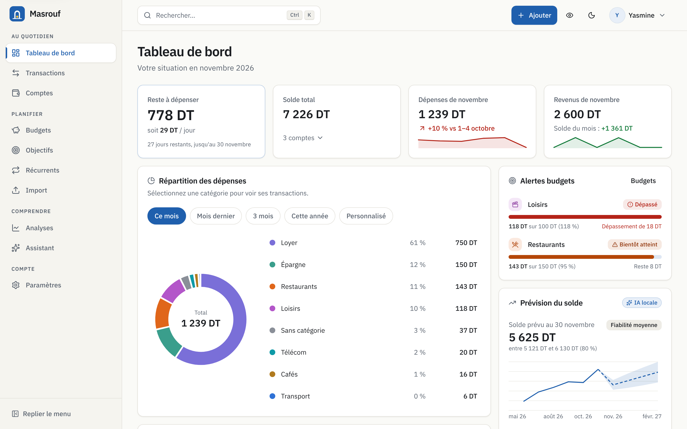
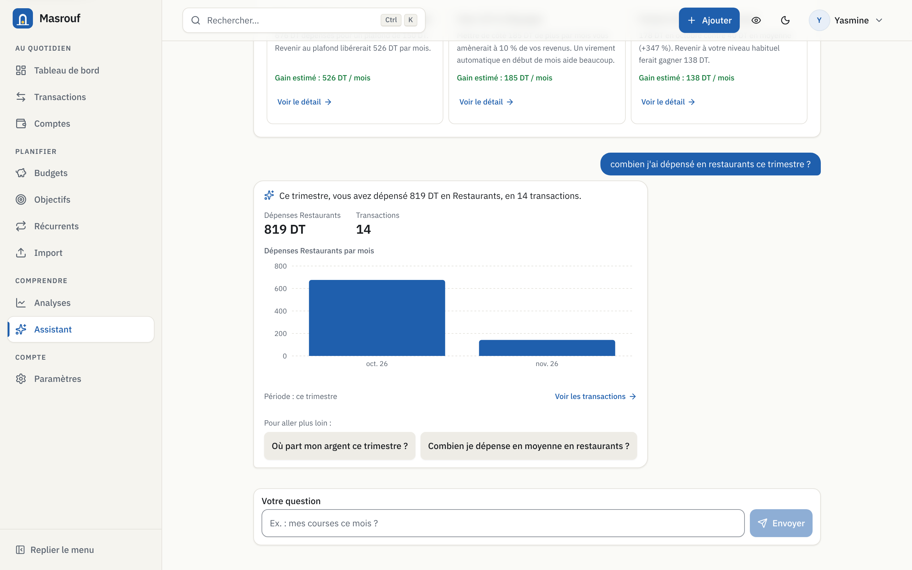
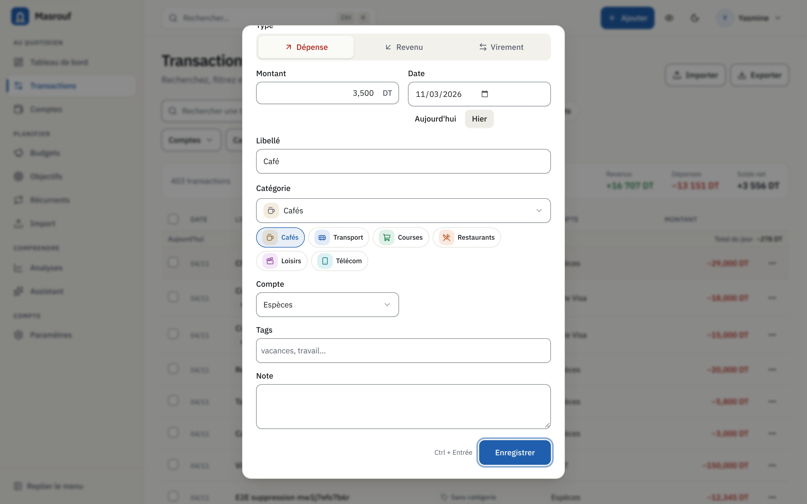
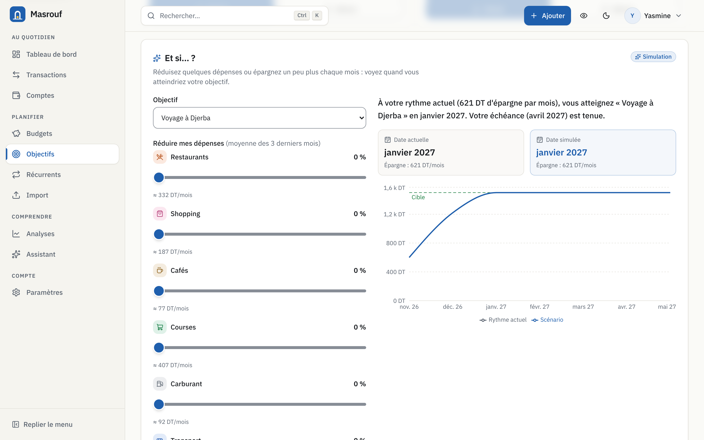
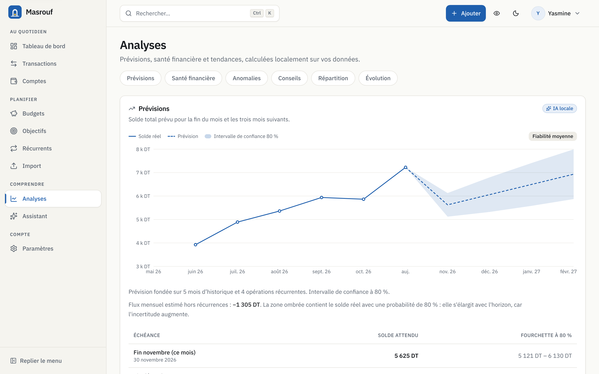
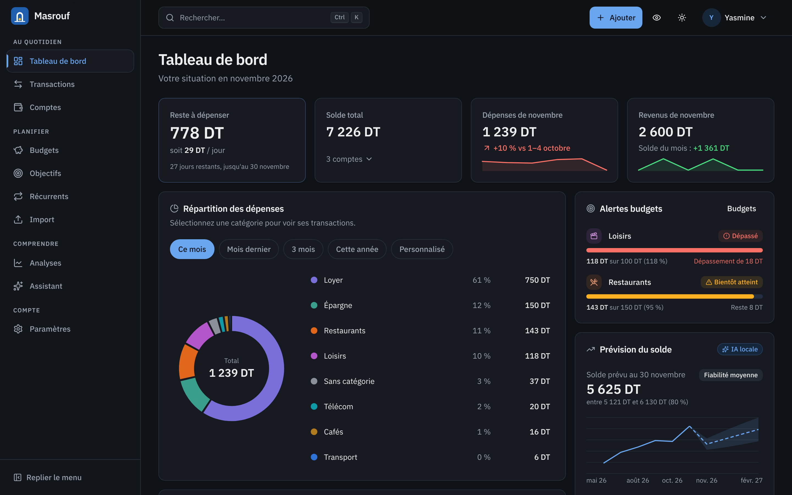
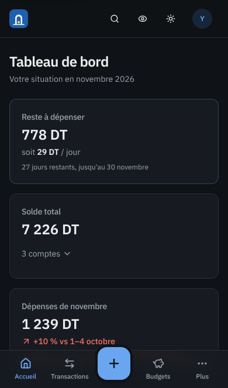
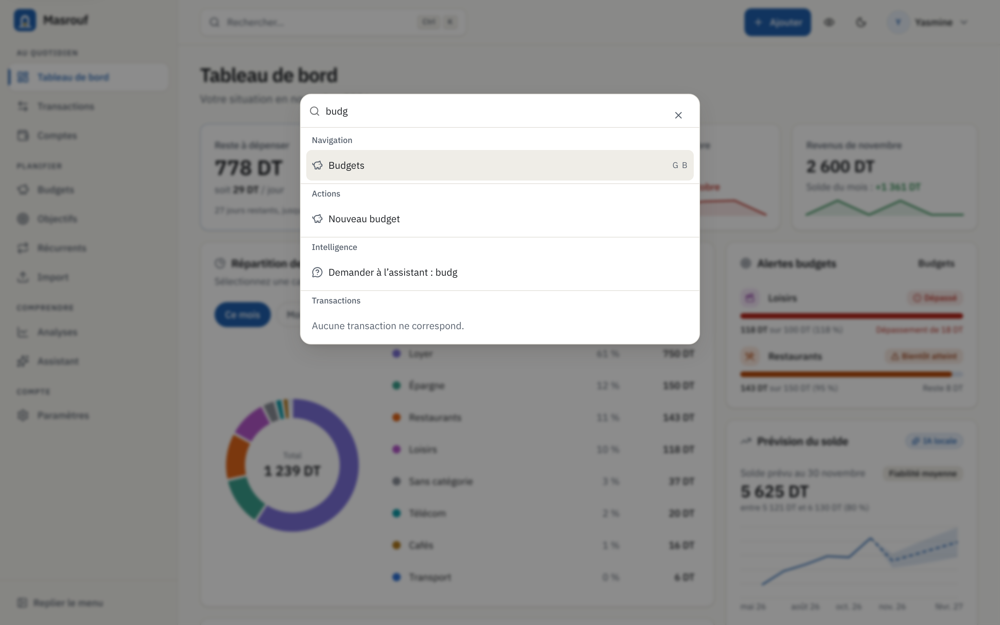
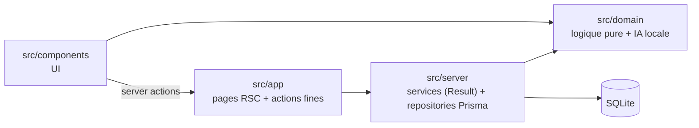

# Masrouf

**Sachez où part chaque dinar.** Masrouf est une application web de gestion de budget personnel en français. La devise par défaut est le dinar tunisien (TND). L'**intelligence artificielle tourne à 100 % en local** : aucune API externe, aucune clé, aucun modèle à télécharger.



| Assistant « Pose une question à tes finances » | Saisie en langage naturel                          |
| ---------------------------------------------- | -------------------------------------------------- |
|    |  |

| Simulateur « Et si… ? »                             | Analyses : prévisions et santé financière  |
| --------------------------------------------------- | ------------------------------------------ |
|  |  |

| Mode sombre                                            | Mobile (sombre)                                               | Palette Ctrl+K                           |
| ------------------------------------------------------ | ------------------------------------------------------------- | ---------------------------------------- |
|  |  |  |

Les autres captures sont dans [`docs/screenshots/`](docs/screenshots) : transactions, budgets, transactions sur mobile.

---

## Installation

Prérequis : **Node.js ≥ 20.9** (22 recommandé) et npm.

```bash
git clone https://github.com/sadokaminbenyahia/masrouf.git
```

```bash
cd masrouf
```

```bash
npm install
```

```bash
cp .env.example .env
```

Dans `.env`, remplacez au minimum `AUTH_SECRET`. Vous pouvez générer une valeur avec `openssl rand -base64 32`. Créez ensuite la base SQLite et chargez les 6 mois de données de démo :

```bash
npx prisma db push
```

```bash
npm run db:seed
```

```bash
npm run dev
```

Ouvrez http://localhost:3000 et connectez-vous avec le **compte de démo** `demo@masrouf.tn` / `Demo1234!`. Vous pouvez aussi créer un compte : un onboarding guidé vous accueille au premier lancement.

### Scripts

| Script                               | Rôle                                                                                                                 |
| ------------------------------------ | -------------------------------------------------------------------------------------------------------------------- |
| `npm run dev` / `build` / `start`    | Développement, build et serveur de production                                                                        |
| `npm run lint`                       | ESLint strict (`--max-warnings=0`), y compris les règles de couches                                                  |
| `npm run typecheck`                  | `tsc --noEmit` (TypeScript strict, `noUncheckedIndexedAccess`)                                                       |
| `npm test` / `npm run test:coverage` | Vitest. La couverture de `src/domain` est imposée (≥ 80 %, actuellement ≈ 99,7 % des lignes)                         |
| `npm run test:e2e`                   | Playwright (desktop et mobile) sur une base jetable `prisma/e2e.db` (`npm run db:e2e`). Lancez `npm run build` avant |
| `npm run db:seed`                    | Seed de démo, idempotent : il recrée seulement l'utilisatrice démo                                                   |
| `npm run format`                     | Prettier, avec le plugin Tailwind                                                                                    |

### Variables d'environnement

Toutes sont documentées dans [`.env.example`](.env.example) :

- `DATABASE_URL` : base de données ;
- `AUTH_SECRET` : refusé en production s'il est absent, s'il vaut la valeur d'exemple ou s'il fait moins de 32 caractères ;
- `AUTH_TRUST_HOST` ;
- `APP_TIMEZONE` : `Africa/Tunis` par défaut ;
- `RATE_LIMIT_*` : seuils de rate limiting ;
- `TRUST_PROXY_HOPS` : nombre de proxys de confiance devant l'app, pour lire l'IP client ;
- `MASROUF_DEMO_MODE` : affiche les identifiants de démo sur la page de connexion.

---

## Stack

Next.js 16 (App Router, proxy) · React 19 · TypeScript strict · Tailwind CSS 4 et composants shadcn/ui (Radix) · Framer Motion · Prisma 6 et SQLite · Zod 4 · Recharts 3 · TanStack Query et TanStack Table · Auth.js v5 (e-mail et mot de passe, bcrypt) · dnd-kit · cmdk · sonner · Vitest · Playwright · GitHub Actions. L'application est une PWA installable, avec un service worker et une page hors-ligne.

## Architecture

Les couches sont strictement séparées, et ESLint fait respecter cette séparation :



- **`src/domain`** ne dépend de rien : ni framework, ni Prisma, ni Zod. Il contient la logique métier et toute l'IA, derrière l'interface unique `AIEngine`.
- **Montants** : entiers en **millimes** (1 TND = 1000 millimes), jamais de float. Une **seule** fonction de formatage, `formatMoney`.
- **Validation** : Zod à chaque frontière (formulaires, server actions, import CSV, sorties de l'IA, modèle IA chargé depuis la base).
- **Erreurs** : type `Result`, aucune erreur avalée. Les exceptions imprévues sont journalisées puis renvoyées en `INTERNAL`.
- **Isolation** : chaque requête est filtrée par `userId`, et l'appartenance de chaque référence est vérifiée avant toute écriture.

Détails, diagrammes Mermaid et flux de données : **[ARCHITECTURE.md](ARCHITECTURE.md)**. Contrats entre modules : **[CONTRACTS.md](CONTRACTS.md)**. Fonctionnalités et justifications : **[FEATURES.md](FEATURES.md)**.

## Fonctionnalités

- **Comptes** espèces, banque et carte, avec soldes calculés et virements entre comptes (retrait DAB compris).
- **Transactions** : catégories, tags, notes, recherche et filtres synchronisés avec l'URL, pagination côté serveur, **édition inline**, sélection multiple, **mises à jour optimistes** et **« Annuler »** dans chaque toast.
- **Import CSV** de relevé bancaire, en 4 étapes :
  - devinette du séparateur et des colonnes (débit/crédit ou montant signé), format de date ;
  - aperçu avec détection des doublons : déjà importés, répétés dans le fichier, ou **doublons possibles** avec une saisie manuelle ;
  - libellés nettoyés ;
  - catégories suggérées par l'IA.
- **Dépenses récurrentes**, créées automatiquement à l'échéance. Les paiements réguliers repérés par l'IA peuvent être ajoutés en 1 clic.
- **Budgets mensuels** par catégorie : barres accessibles, alertes à 80 % et 100 %, projection de fin de mois, **glisser-déposer** (également au clavier).
- **Objectifs d'épargne** : versements, date cible, glisser-déposer, petite célébration à l'atteinte.
- **Tableau de bord** :
  - reste à dépenser par jour, solde total, dépenses comparées « à date » au mois précédent ;
  - **camembert cliquable** qui ouvre les transactions filtrées, avec sélecteur de période ;
  - courbe sur 12 mois, top 5 des dépenses, conseils (règle 50/30/20, catégories en hausse de 30 % ou plus, abonnements oubliés).
- **Export CSV**, compatible Excel FR (`;`, BOM), avec protection contre l'injection de formules.
- **Interactivité** :
  - palette de commandes **Ctrl+K** ;
  - ajout rapide depuis toutes les pages (`N`) ;
  - raccourcis `g` + lettre pour naviguer, `?` pour l'aide ;
  - mode discret (montants masqués), mode sombre, animations discrètes qui respectent `prefers-reduced-motion` ;
  - navigation clavier complète et contrastes AA.

## IA 100 % locale

Toute l'IA est écrite en TypeScript dans [`src/domain/ai`](src/domain/ai). Elle tourne sur le serveur de l'application, derrière l'interface [`AIEngine`](src/domain/ai/engine.ts). L'implémentation actuelle est `LocalAIEngine`, injectée en un seul point (`src/server/ai/engine.ts`) : on peut la remplacer sans toucher au reste.

| Fonctionnalité                                               | Technique                                                                                                                                                                                                                                                                                                                                                                                                                              |
| ------------------------------------------------------------ | -------------------------------------------------------------------------------------------------------------------------------------------------------------------------------------------------------------------------------------------------------------------------------------------------------------------------------------------------------------------------------------------------------------------------------------- |
| **Catégorisation automatique** (saisies et lignes importées) | Naïf bayésien multinomial : tokens, bigrammes, trigrammes du marchand, tranche de montant, lissage de Laplace. Une table marchand → catégorie, apprise des **corrections de l'utilisateur**, est prioritaire. Au démarrage, des règles par mots-clés tunisiens prennent le relais (Carrefour, Aziza, STEG, Ooredoo, louage…). Modèle persisté en JSON par utilisateur. Exactitude ≈ 0,97 sur le jeu de référence.                      |
| **Saisie en langage naturel**                                | Règles et regex. « café 3,500 hier », « salaire 2400 le 1er », « taxi 7 dt », « 500 millimes pain », « cinéma 18 dinars en espèces » sont reconnus, ainsi que les dates relatives et les jours de la semaine.                                                                                                                                                                                                                          |
| **Anomalies**                                                | z-score robuste (médiane/MAD) sur log(montant), avec repli sur l'IQR : dépense inhabituelle. Même marchand et même montant à ±2 jours : doublon suspect. Hausse de plus de 5 % d'un abonnement.                                                                                                                                                                                                                                        |
| **Prévisions**                                               | Solde de fin de mois et des 3 mois suivants : récurrences déterministes, flux variable en moyenne exponentielle, régression linéaire, saisonnalité à partir de 13 mois. Le graphique affiche l'**intervalle de confiance à 80 %**.                                                                                                                                                                                                     |
| **Assistant « Pose une question à tes finances »**           | Détection d'intention (14 intentions) et extraction de la période, de la catégorie et du montant en français (« ce trimestre », « en mars », « depuis janvier »…). Les chiffres viennent ensuite d'**outils typés** (`FinanceTools`) qui interrogent la base, jamais inventés. La réponse est chiffrée, avec un mini-graphique et un lien vers les transactions. Si la question n'est pas comprise, l'assistant propose des questions. |
| **Résumé mensuel**                                           | Faits classés par intérêt, gabarits de phrases variés (choix déterministe), **3 recommandations** chiffrées.                                                                                                                                                                                                                                                                                                                           |
| **Simulateur « Et si… ? »**                                  | Réduction de X % sur une catégorie, plus une épargne supplémentaire. Le simulateur calcule la nouvelle date d'atteinte de l'objectif et le nombre de mois gagnés.                                                                                                                                                                                                                                                                      |
| **Score de santé financière (0–100)**                        | 7 sous-scores pondérés (taux d'épargne, fonds d'urgence, charges fixes, budgets, stabilité, tendance, objectifs), chacun avec son explication et le levier prioritaire.                                                                                                                                                                                                                                                                |
| **En plus**                                                  | Détection automatique des récurrences, suggestions de budgets (70e centile), nettoyage des libellés bancaires.                                                                                                                                                                                                                                                                                                                         |

Les tests E2E vérifient qu'**aucune requête réseau ne sort** de l'application pendant l'utilisation de l'assistant.

## Qualité et sécurité

- **CI GitHub Actions** : format, lint, typecheck, tests avec couverture, build, puis E2E Playwright. Les actions sont épinglées par SHA et les permissions minimales.
- **Tests** : environ 1 060 tests unitaires et 31 tests E2E (parcours principaux, dont l'assistant IA, le langage naturel, l'import CSV, la palette et le mobile). Les tests unitaires couvrent :
  - le domaine et les calculs en millimes (invariants) ;
  - le parsing CSV (aller-retour) ;
  - le moteur IA, avec des jeux de référence ;
  - les schémas Zod ;
  - l'isolation des requêtes Prisma par `userId`.
- **Sécurité** :
  - mots de passe hachés avec bcrypt ;
  - rate limiting sur l'authentification (e-mail, IP de confiance, plafond global d'inscriptions) et sur l'IA ;
  - CSP à nonce par requête, HSTS, `X-Frame-Options`, nosniff, Permissions-Policy ;
  - sessions révocables (« Déconnecter tous les appareils ») ;
  - redirections post-connexion validées ;
  - montants plafonnés à la capacité des colonnes ;
  - le service worker ne met jamais en cache de données privées.
- **Risques résiduels assumés** :
  - le rate limiting est en mémoire, à remplacer par un stockage partagé en multi-instances ;
  - l'inscription permet de savoir si un e-mail est déjà utilisé, en l'absence de vérification par e-mail (atténué par le rate limiting).

## Arborescence

```
prisma/            schéma + seed de démo
src/domain/        logique pure : money, dates, savings, csv/, ai/ (moteur local)
src/server/        auth, sécurité, repositories Prisma, services
src/app/           pages (App Router), server actions, routes API
src/components/    UI (shadcn/ui, graphiques, fonctionnalités)
src/lib/           schémas Zod, TanStack Query, hooks
e2e/ · tests/      Playwright · Vitest transverses
docs/              conception de l'IA, captures
```
